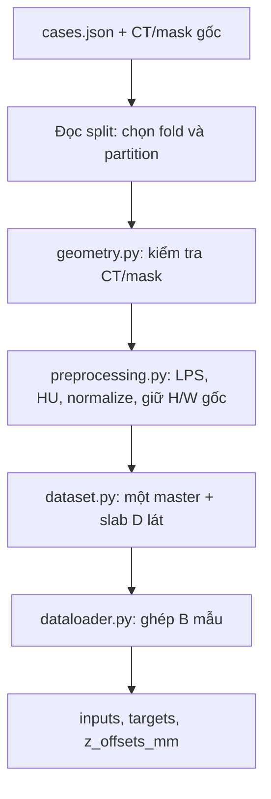

# COVID-19 CT — bắt đầu từ dữ liệu đến batch đầu vào

Repository hiện có pipeline dữ liệu và evaluator độc lập model cho dự án
MERIT-UNETR++. **Chưa triển khai model hoặc training loop.** Điểm bắt đầu để lấy
input sau này là [examples/read_training_batch.py](examples/read_training_batch.py).

## 1. Mới vào dự án: đọc gì trước?

Nếu mới tiếp cận, đi theo thứ tự này:

1. Đọc **mục 2 của README này** để biết CT/mask, manifest và split nằm ở đâu.
2. Đọc [ví dụ A-0025](docs/giai_thich_csv_A0025.md), mở CSV và ảnh trong
   [báo cáo dữ liệu](analysis/covid19_20/REPORT.md) để nối thuật ngữ với một volume thật.
3. Chạy **mục 3**, rồi đọc **mục 4**: xác định input, mask của lát trung tâm,
   offsets và shape batch. Ví dụ chỉ đọc dữ liệu, chưa huấn luyện.
4. Đọc [bản đồ source](ct_pipeline/README.md), sau đó đi lần lượt
   `config → cases → splits → geometry → preprocessing → dataset → dataloader`.
5. Khi đã hiểu batch và cần nối model, dùng `build_fold_loaders()` ở mục 4.
   Sau khi có prediction mới đọc phần evaluator trong [hướng dẫn chi tiết](docs/data_pipeline.md).

Không cần đọc hết audit JSON hoặc lịch sử thay đổi trước khi chạy batch đầu tiên.
Bảng dưới là chỗ tra nhanh khi đã biết mình cần tìm phần nào:

| Bạn muốn làm gì? | Mở file nào? |
| --- | --- |
| Chạy thử xem một batch gồm những gì | [examples/read_training_batch.py](examples/read_training_batch.py) |
| Đổi số lát, kích thước ảnh, HU window | [ct_pipeline/config.py](ct_pipeline/config.py) |
| Hiểu thứ tự gọi các hàm trong source | [ct_pipeline/README.md](ct_pipeline/README.md) |
| Xem code kiểm tra hình học và restore prediction | [ct_pipeline/geometry.py](ct_pipeline/geometry.py) |
| Xem code LPS → normalize → giữ kích thước gốc | [ct_pipeline/preprocessing.py](ct_pipeline/preprocessing.py), hàm `read_volume()` |
| Xem cách cắt 11 lát và chọn mask master | [ct_pipeline/dataset.py](ct_pipeline/dataset.py), `CTSlabDataset.__getitem__()` |
| Xem cách chọn fold và ghép batch | [ct_pipeline/dataloader.py](ct_pipeline/dataloader.py), `build_fold_loaders()` |
| Xem báo cáo từng volume | [REPORT.md](analysis/covid19_20/REPORT.md), [case_statistics.csv](analysis/covid19_20/case_statistics.csv) |
| Hiểu các cột CSV bằng một ca thật | [Ví dụ A-0025, đủ 71 trường](docs/giai_thich_csv_A0025.md) |

## 2. Input thực sự được lấy từ đâu?

Train sau này đọc **CT NIfTI + mask NIfTI**, dựa vào manifest và split:

| Dataset | Vai trò | Nguồn dữ liệu |
| --- | --- | --- |
| COVID-19-20, 199 cặp CT/lesion mask | Primary cho split và pipeline hiện tại | [Bản phân phối trên Hugging Face](https://huggingface.co/datasets/MedOtter/COVID-19-20) |
| Zenodo20, 20 ca | External test dự kiến ở giai đoạn sau, không trộn vào primary | [Zenodo record 3757476](https://zenodo.org/records/3757476) |

```text
data/covid19_20/
├── cases.json                         Danh sách CT/mask và mã từng volume
└── Train/
    ├── volume-covid19-A-0025_ct.nii.gz  CT 3D gốc
    └── volume-covid19-A-0025_seg.nii.gz GT mask 3D, nhãn 0/1

splits/covid19_20_5fold.json             Case IDs của từng fold/partition
```

- `cases.json` cho biết file CT nào đi cùng mask nào.
- `split JSON` cho biết volume thuộc train/validation/test trong fold được chọn.
- `case_statistics.csv`, `audit.json` và các PNG là báo cáo, **không phải nguồn
  tensor đầu vào bắt buộc** của Dataset.
- Dữ liệu gốc giữ nguyên trên ổ đĩa. Preprocessing tạo mảng/tensor trong RAM khi
  đọc từng volume, không tạo ba bản sao CT cho train/validation/test.

Luồng source tương ứng:



## 3. Chạy nhanh trên Windows PowerShell

Nếu máy chưa có repository, lấy đúng nhánh `Duong` trước:

```powershell
git clone --branch Duong --single-branch https://github.com/torusama/merit-covid-ct.git
Set-Location merit-covid-ct
```

Chạy các lệnh dưới từ thư mục chứa README này. Máy đã có `.venv` và dataset thì
bỏ qua bước tạo môi trường/tải dữ liệu. Phiên kiểm tra dùng Python 3.13, CPU.

```powershell
# Chỉ khi cần tạo môi trường mới.
python -m venv .venv
.\.venv\Scripts\python.exe -m pip install torch --index-url https://download.pytorch.org/whl/cpu
.\.venv\Scripts\python.exe -m pip install -r requirements.txt

# Chỉ tải primary dataset nếu chưa có manifest.
if (-not (Test-Path data/covid19_20/cases.json)) {
    .\.venv\Scripts\python.exe tools/download_covid19_20.py
}

# Chỉ đọc/in một batch thật của fold 0; không train.
.\.venv\Scripts\python.exe examples/read_training_batch.py --fold 0 --partition train --batch-size 2 --assume-mm
```

`--assume-mm` được dùng chủ động vì ba ca A-0161, A-0585, A-0599 thiếu đơn vị
trong header. Đây là giả định cần xác minh từ nguồn. Mặc định code từ chối unknown;
các ca vốn có đơn vị mm không bị thay đổi đơn vị.

Ví dụ sẽ in số volume và số master của từng partition, case IDs trong batch,
master indices, shape/dtype input và target, cùng offsets mm. Batch đầu có thể
chỉ có mask 0 vì Dataset lấy cả các lát không có tổn thương.

## 4. Sau này code train lấy biến nào?

API dùng chung được export ở `ct_pipeline/__init__.py`. Đoạn dưới chỉ đọc dữ liệu:

```python
from ct_pipeline import PreprocessConfig, build_fold_loaders


def main():
    # Cùng cấu hình cho cả train, validation và test.
    preprocess = PreprocessConfig(
        slab_size=11,
        size_hw=None,  # Giữ kích thước gốc từng lát, không resize.
        hu_window=(-1000.0, 400.0),
        intensity_encoding="auto_hu",
        assume_mm=True,  # Chấp nhận giả định mm cho 3 ca thiếu đơn vị.
    )

    loaders = build_fold_loaders(
        manifest="data/covid19_20/cases.json",
        split_path="splits/covid19_20_5fold.json",
        fold=0,
        preprocess=preprocess,
        batch_size=2,
        shuffle_train=False,  # Ví dụ giữ thứ tự để dễ kiểm tra.
        seed=42,
        num_workers=0,
    )

    batch = next(iter(loaders.train))
    inputs = batch["image_slab"]       # [B, 1, D, H, W]
    targets = batch["master_mask"]     # [B, 1, H, W]
    offsets_mm = batch["z_offsets_mm"] # [B, D]

    print(inputs.shape, targets.shape, offsets_mm.shape)
    # Model/loss/optimizer sẽ được bổ sung ở giai đoạn training sau này.


if __name__ == "__main__":
    main()
```

| Biến/trường | Shape với B=2, D=11, lát gốc 512×512 | Dùng để làm gì? |
| --- | --- | --- |
| `inputs` / `image_slab` | `[2,1,11,512,512]`, float32 | Hai mẫu CT, mỗi mẫu một kênh và 11 lát |
| `targets` / `master_mask` | `[2,1,512,512]`, float32, 0/1 | GT của riêng lát master ở mỗi mẫu |
| `offsets_mm` / `z_offsets_mm` | `[2,11]`, float32 | Khoảng cách có dấu từng lát tới master |
| `case_id`, `group_id` | List dài B | Giữ identity và truy vết mẫu |
| `master_slice_index` | `[B]`, chỉ số canonical 0-based | Xác định lát đang dự đoán |
| `slice_indices` | `[B,D]` | Chỉ số lát thực sau padding biên |
| `slice_positions_mm` | `[B,D,3]` | Tâm lát trong RAS world mm |
| `metadata` | List B dictionary | Geometry gốc và thông tin restore prediction |

`B` là batch size, `D` là số lát của slab; H=Y và W=X trong tensor.
NIfTI/metadata dùng thứ tự X,Y,Z; tensor volume nội bộ dùng Z,Y,X.
Đây là hợp đồng của pipeline; khi thêm model phải khớp hợp đồng này.

Để đọc validation/test, thay `loaders.train` bằng `loaders.validation` hoặc
`loaders.test`. Hai loader này luôn giữ thứ tự. `shuffle_train=True` có thể dùng
cho train với seed cố định, nhưng shuffle từng lát có thể giải nén CT lặp nhiều
lần vì cache chỉ giữ một volume/worker; không preload 199 ca để tránh chuyện đó.

**Một mẫu là một master slice, không phải một volume.** Dataset duyệt mọi master
0…Z−1, kể cả GT rỗng. Ở fold 0 hiện có 127 train volumes tương ứng 8.810 master
samples. `len(dataset.cases)` đếm volumes; `len(dataset)` đếm master samples;
`len(loader)` đếm batches.

## 5. Quy ước hiện tại: LPS và độ phân giải gốc

`read_volume()` thống nhất hướng mảng theo LPS và **không resize mặc định**:

| Bước | Vì sao dùng trong pipeline này? | Thao tác thực tế |
| --- | --- | --- |
| Thống nhất orientation LPS | Cùng quy ước hướng/trật tự lát giữa các volume | Giữ thứ tự 193 volume LPS; đảo Z của 6 volume LPI, cùng mask và affine; không nội suy |
| Giữ H,W gốc (`size_hw=None`) | Giữ chi tiết không gian của đầu vào và nhãn | Không crop, thu nhỏ hay phóng to; không tạo voxel mới |
| HU window/normalize | Cùng thang cường độ đầu vào | Clip [-1000,400], đưa về [0,1]; chỉ áp dụng cho CT |

Ca A-0025 đã LPS: giữ nguyên mảng 512×512×61, sau đó chỉ window/normalize CT.
Mask giữ nguyên giá trị voxel. LPS là quy ước chọn theo dataset này, không phải
yêu cầu bắt buộc của mọi mô hình. RAS trước đây cũng là hướng hợp lệ.

`canonical_*` trong metadata/CSV nay chỉ grid **đã thống nhất LPS**. Tọa độ world
của affine NiBabel vẫn là RAS+; hướng mảng LPS không thay đổi quy ước world này.
Prediction/metadata RAS của phiên bản cũ không dùng chung với pipeline LPS.

Resize chỉ còn là tùy chọn chủ động: `size_hw=(H,W)` trong Python hoặc `--size H W`
ở CLI. CT dùng bilinear, mask nearest-exact. Không có căn cứ thực nghiệm để mặc
định giảm xuống 256×256. Nếu H,W giữa các ca khác nhau, dùng batch size 1 hoặc
gom các mẫu cùng shape; không tự thu nhỏ ảnh để ghép batch.

Tất cả volume vẫn giữ số lát/spacing dọc trục lát gốc. Slab 11 lát, Z=5 mm,
master 30 lấy 25–35 và offsets −25…25 mm. Gần biên lặp lát biên để đủ D; không
thêm lát vào NIfTI gốc. `auto_hu` chỉ kiểm tra range sau scaling, chưa chứng minh
calibration HU từ DICOM.

## 6. Split đã có sẵn, không chia lại trong DataLoader

`build_fold_loaders()` đọc và kiểm tra split đã lưu. Nó không chọn seed mới hoặc
viết lại danh sách mỗi lần đọc batch.

| Fold | Train volumes | Validation volumes | Test volumes |
| --- | ---: | ---: | ---: |
| 0–3, mỗi fold | 127 | 32 | 40 |
| 4 | 128 | 32 | 39 |

Test luân phiên qua năm nhóm. Validation lấy khoảng 20% phần còn lại trong từng
fold. Mỗi volume test đúng một lần qua năm fold, không bắt buộc validation đúng
một lần. Nếu train đủ 5-fold sau này phải khởi tạo/train model riêng mỗi fold.

**Patient-level independence chưa xác minh.** Manifest hiện chỉ có volume ID,
nên `group_id=case_id`. Code giữ mọi lát của một volume chung partition; cần
patient mapping đáng tin cậy để gom nhiều volume của cùng người. Có thể truyền
`patient_map=...` khi tạo loaders sau khi tạo lại split bằng cùng mapping đó.
CSV/biểu đồ GT toàn cohort chỉ mô tả dữ liệu, không được tự dùng test để chọn
hyperparameters, threshold hoặc checkpoint.

## 7. Các lệnh kiểm tra và báo cáo

```powershell
# Tests phần mềm, dùng fixtures tổng hợp nhỏ, không phải kết quả model.
.\.venv\Scripts\python.exe -m pytest -q

# Kiểm tra Windows worker. Vẫn chỉ đọc batch.
.\.venv\Scripts\python.exe examples/read_training_batch.py --assume-mm --workers 1

# Xuất ảnh CT + GT của ca thật vào outputs/ (không thay ảnh báo cáo đã lưu).
.\.venv\Scripts\python.exe tools/data_pipeline.py smoke --assume-mm --case-id volume-covid19-A-0025 --master 30 --output outputs/inspection.png --report outputs/inspection.json

# Tạo lại bảng 199 volumes và biểu đồ khi đã có audit đầy đủ.
.\.venv\Scripts\python.exe tools/summarize_covid19_20.py --assume-mm

# Chỉ tạo lại split khi chủ động muốn ghi lại danh sách.
.\.venv\Scripts\python.exe tools/data_pipeline.py split --seed 42
```

Lệnh `tools/data_pipeline.py audit` đọc toàn bộ CT/mask để kiểm tra preprocessing.
Mặc định từ chối ba ca thiếu đơn vị; thêm `--assume-mm` khi chủ động chấp nhận
giả định. Xem [hướng dẫn CLI và evaluator](docs/data_pipeline.md) để chạy audit
hoặc đánh giá các prediction thực khi có model.

Evaluator ở [ct_pipeline/metrics.py](ct_pipeline/metrics.py) ghép đủ prediction
master slices, restore về native geometry qua `geometry.restore_volume()` rồi
tính foreground Dice/IoU trên toàn volume. Không lấy mean Dice từng lát làm Dice
volume. Threshold chọn bằng validation trước; không chọn bằng test.

## 8. Bản đồ folder và tài liệu

```text
ct_pipeline/   Source dùng chung: config → geometry → preprocessing → Dataset → loader
examples/      Ví dụ đọc input thật, điểm bắt đầu khi nối code train sau này
tools/         CLI tải dữ liệu, audit, split, smoke, báo cáo và evaluator
data/          CT/mask + manifest trên máy local; không commit
splits/        Danh sách chia đã lưu trên Git
analysis/      CSV, summary, báo cáo và biểu đồ dataset
outputs/       Ảnh/JSON xuất khi chạy kiểm tra; chỉ hai PNG mẫu được theo dõi sẵn
tests/         Kiểm thử phần mềm; không phải dữ liệu/model results
docs/          Hướng dẫn chi tiết và định hướng nghiên cứu
```

- [Source: đọc từ file nào đến file nào?](ct_pipeline/README.md)
- [Giải thích CSV bằng A-0025](docs/giai_thich_csv_A0025.md)
- [Báo cáo primary dataset](analysis/covid19_20/REPORT.md)
- [Cách đọc báo cáo COVID-19-20 và Zenodo20](docs/dataset_reports.md)
- [Lịch sử thay đổi](THAY_DOI.md)
- [Định hướng kiến trúc/nghiên cứu, chưa triển khai](docs/research_plan.md)

Scope hiện tại dùng COVID-19-20 primary, không tải/xử lý thêm Zenodo20.
Dữ liệu, .venv và cache giữ ở local theo .gitignore. Các limitations về patient ID
và ba ca thiếu đơn vị vẫn cần xác minh từ nguồn trước khi tuyên bố protocol
patient-level đã được bảo đảm.
