# Base architecture

This package implements data/evaluation infrastructure. There is no training loop
or implemented research architecture. New business logic is in `src/`; new scripts
dispatch into the package. Existing acquisition and historical visualization stay
in their original locations to preserve behavior without a disruptive migration.

```text
README.md, pyproject.toml, requirements.txt, .gitignore
configs/
  experiment_baseline.yaml
src/merit_covid/
  __init__.py, config.py, cli.py, utils.py
  data/
    __init__.py
    manifest.py
    nifti_io.py
    preprocessing.py
    slab.py
    splitting.py
    dataset.py
  engine/
    __init__.py, metrics.py, reconstruction.py
  models/
    __init__.py, base.py
    merit_unetrpp/README.md
scripts/
  check_dataset.py, make_splits.py, smoke_test.py
tests/
  conftest.py
  test_manifest.py, test_nifti_io.py, test_preprocessing.py
  test_slab.py, test_splitting.py, test_dataset.py
  test_metrics.py, test_reconstruction.py
  test_config_models_tools.py, test_legacy_tools.py, test_cli.py
splits/covid19_20/folds_seed42.json
docs/
  source_audit.md, architecture.md, data_contract.md
  implementation_roadmap.md, implementation_report.md
tools/                 Existing download, preparation, audit, plotting and viewer
analysis/zenodo20/     Existing results, preserved without regeneration
data/, archives/       Local originals/archives; ignored
outputs/               Derived files; ignored
```

## Responsibilities

| Module | Responsibility |
| --- | --- |
| config.py | Validated immutable settings and config-relative paths |
| utils.py | Explicit Python/NumPy seeds and optional torch deterministic setup |
| cli.py | Dataset checks, split generation and synthetic smoke workflow |
| data/manifest.py | Unified Case, legacy reader, duplicate/path checks, exclusive writer, actual-file lung resolver |
| data/nifti_io.py | Header and paired geometry validation, binary masks, RAS conversion, preserved original geometry/export |
| data/preprocessing.py | Explicit normalization, linear image/nearest mask XY resize, loss warnings and inverse geometry |
| data/slab.py | Ordered master/context sampling, edge/reflect padding, affine-based physical offsets |
| data/splitting.py | Seeded patient/volume folds, fingerprint, leakage and coverage validation, immutable JSON |
| data/dataset.py | Modes, label-free inference, bounded lazy cache, optional DataLoader and worker seeding |
| engine/reconstruction.py | Canonical volume assembly; reject missing/duplicate slices |
| engine/metrics.py | Binary metrics, linked-patient voxel pooling and equal-weight macro average |
| models/base.py | Future master-logit protocol and 2D master selection |
| models/merit_unetrpp/README.md | Original-source integration requirements |
| scripts/*.py | Thin CLI entry points |
| tools/*.py | Preserved acquisition/analysis/viewer workflows using shared ID/path/geometry helpers |

No existing file moved. `prepare_zenodo20.case_id` retains its name and delegates to
the shared normalizer. `view_slices.load_case_images` unifies GUI/preview path and
geometry checks. Legacy tool-specific analysis and download logic remain in tools;
the shared training pipeline does not depend on those modules.

## Dependency and data flow

```mermaid
flowchart LR
    Manifest[Manifest and split selection] --> IO[Paired NIfTI and RAS geometry]
    IO --> Prep[Explicit normalization and XY preprocessing]
    Prep --> Slab[Master/context sampling]
    Slab --> Loader[Dataset / optional torch DataLoader]
    Loader --> Model[Future model adapter]
    Model --> Prediction[Master logits and fixed threshold]
    Prediction --> Reconstruction[Indexed canonical volume]
    Reconstruction --> Inverse[Inverse XY and orientation]
    Inverse --> Export[Original-grid NIfTI]
    Inverse --> Metrics[Original-grid patient metrics]
```



Data modules do not import model or engine code. Model adapters own architecture
layout and auxiliary predictions; they return `[B,1,H,W]` logits. Engine utilities
consume arrays and indexes independently of a model/trainer. Training orchestration,
checkpoint selection, optimizer/loss and threshold policy remain future work.

Core modules do not require torch. Its DataLoader and deterministic seed support
import it only when explicitly used. Variable geometry metadata stays with each
prepared volume, outside batch collation. The one-volume LRU cache bounds normal
per-worker retention, but each worker loads full CT arrays; profile RAM and worker
count before training at scale.

Paths use pathlib; no storage vendor or CUDA device is hardcoded. On Windows,
multiprocess DataLoader callers need an `if __name__ == '__main__'` guard. Linux
and Colab use the same package, but this session verifies Windows runtime only.
