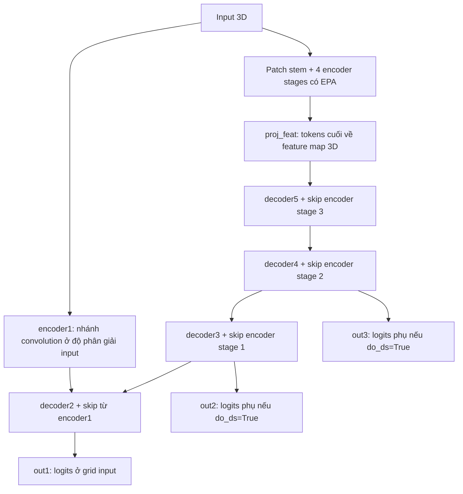

# UNETR++ baseline trên nhánh MERGE

## 1. Trước hết: đã làm đến đâu?

**Đã có kiến trúc UNETR++ 3D, adapter lấy logits lát master, cấu hình model,
ví dụ chạy bằng dữ liệu tổng hợp và tests. Model chưa được train.** Không có
checkpoint, pretrained weights của dự án, kết quả Dice/IoU/HD95 hay so sánh mô hình.

Pipeline MERGE vẫn xuất slab `[B,1,11,512,512]` và GT của riêng lát master
`[B,1,512,512]`. Model gốc được kiểm chứng ở kích thước `[B,1,64,128,128]`.
**Hai kích thước này chưa nối trực tiếp được.** Adapter bên dưới chỉ nối cách
lấy output, không tự sửa input. Bàn giao lần này hoàn thành phần kiến trúc;
người phụ trách training còn phải quyết định protocol chuẩn bị input/supervision.

Không sửa preprocessing, split, CT/mask gốc, DataLoader hay evaluator để chạy model.

## 2. Vì sao có baseline này? “Gốc” là bản nào?

UNETR++ là mạng phân đoạn ảnh y khoa 3D của Shaker và cộng sự. Đầu vào là một
khối ảnh; đầu ra là các điểm số phân đoạn cho từng voxel. Nhóm cần một model
độc lập làm mốc trước khi nghiên cứu MERIT-UNETR++. Bản này chỉ chứa UNETR++;
chưa có các thành phần nghiên cứu MERIT, TEP, MER hoặc PCG.

Repository chính thức có các biến thể Synapse, Lung, ACDC và Tumor. Chúng có
khác biệt thực tế; ví dụ Synapse dùng chung lớp chiếu E/F trong EPA và có một
residual conv block trong mỗi transformer, còn bản Lung tại commit này dùng
hai lớp chiếu riêng và thêm một residual conv block. Vì vậy không trộn file
của các biến thể rồi gọi đó là một kiến trúc gốc duy nhất.

Ở đây chọn **đồng nhất bản Synapse**, có source, cấu hình tham chiếu và kiểm
chứng đối chiếu cụ thể. Đây là lựa chọn mốc để tích hợp, **không phải kết luận
Synapse tốt hơn Lung cho COVID-19**. Chưa chạy thí nghiệm nào để kết luận đó.

- [Repository chính thức](https://github.com/Amshaker/unetr_plus_plus).
- Commit cố định: [`dcba1c6e8179b77e2ec72b5f4daced8926259f01`](https://github.com/Amshaker/unetr_plus_plus/commit/dcba1c6e8179b77e2ec72b5f4daced8926259f01).
- [Model Synapse gốc](https://github.com/Amshaker/unetr_plus_plus/blob/dcba1c6e8179b77e2ec72b5f4daced8926259f01/unetr_pp/network_architecture/synapse/unetr_pp_synapse.py).
- [Nơi tác giả khởi tạo model](https://github.com/Amshaker/unetr_plus_plus/blob/dcba1c6e8179b77e2ec72b5f4daced8926259f01/unetr_pp/training/network_training/unetr_pp_trainer_synapse.py).

## 3. Đi theo một input để hiểu kiến trúc

Một tensor `[B,C,D,H,W]` gồm B mẫu, C kênh ảnh, D lát, chiều cao H và chiều
rộng W. Một mẫu có thể là một khối lấy từ CT; không nhất thiết là cả CT bệnh
nhân. Kích thước dùng trong ví dụ gốc dưới đây là `64×128×128`, **không phải
lệnh resize dataset hiện tại**.

Luồng gọi trong `UNETRPP.forward()`:



### Patch embedding và encoder

Patch stem là convolution 3D có kernel/stride `(2,4,4)`. Nó học cách biến một
vùng CT thành các đặc trưng nhiều kênh. Sau đó ba convolution stride `(2,2,2)`
tiếp tục giảm kích thước feature map; mỗi stage có ba transformer block trong
cấu hình gốc. Các phép này là **tính toán bên trong mạng**; không ghi lại CT
hoặc thay preprocessing của dataset.

| Điểm trong mạng, với B=1 | Shape trong cấu hình gốc |
| --- | --- |
| Input | `[1,1,64,128,128]` |
| encoder1, nhánh convolution riêng | `[1,16,64,128,128]` |
| Encoder stage 1 | `[1,32,32,32,32]` |
| Encoder stage 2 | `[1,64,16,16,16]` |
| Encoder stage 3 | `[1,128,8,8,8]` |
| Encoder stage 4 trước flatten | `[1,256,4,4,4]` |
| Encoder stage 4 sau flatten | `[1,64,256]`: 64 tokens, mỗi token 256 đặc trưng |

### EPA và transformer block

EPA nhận tokens `[B,N,C]`: N vị trí không gian, C đặc trưng mỗi vị trí.
Hai nhánh attention học quan hệ giữa các kênh và giữa các vị trí. Chúng dùng
chung query/key; bản Synapse còn dùng chung lớp chiếu `E` và `F`, giảm trục
token N xuống P trong nhánh spatial. Sau đó mỗi nhánh được chiếu xuống C/2,
ghép lại thành C. Code giữ đúng phép permute/reshape của source gốc.

Transformer block thêm positional embedding học được, LayerNorm, EPA có hệ số
`gamma` khởi tạo `1e-6`, rồi nhánh convolution residual. Không thay EPA bằng
attention khác. Positional embedding và lớp chiếu theo N khiến kích thước
token grid được cố định khi khởi tạo model.

### Decoder, skip connections và segmentation head

Decoder dùng transposed convolution để tăng kích thước feature map. Ở từng
mức, nó **cộng** feature map với skip từ encoder cùng shape; không thay phép
cộng này bằng concat. Ba mức đầu đi qua transformer; mức cuối dùng residual
convolution. Skip giúp đưa lại thông tin từ các mức có độ phân giải cao hơn.

Segmentation head là convolution `1×1×1` đổi số kênh đặc trưng sang số lớp
đầu ra. Với bài toán nhị phân, cấu hình dự án đặt `out_channels=1`. Kết quả là
**logits**, có thể âm hoặc dương. Model không tự sigmoid, softmax hay threshold.

### Deep supervision

Mặc định `do_ds=True`, theo source gốc, `forward()` trả list theo thứ tự:

| Phần tử | Shape cấu hình gốc, output một kênh | Ý nghĩa |
| --- | --- | --- |
| `output[0]` / out1 | `[B,1,64,128,128]` | Logits chính tại grid input |
| `output[1]` / out2 | `[B,1,32,32,32]` | Logits phụ tại grid patch stem |
| `output[2]` / out3 | `[B,1,16,16,16]` | Logits phụ tại grid thô hơn tiếp theo |

Các đầu ra phụ có thể dùng để đặt loss ở nhiều mức khi có GT phù hợp. Module
chỉ trả logits; chưa chọn loss, trọng số loss hoặc cách tạo target đa tỉ lệ.
`do_ds=False` trả một tensor logits 3D chính. Không tự upsample logits phụ.

## 4. Đọc file nào trước?

1. [model.py](../src/merit_covid/models/unetrpp/model.py): constructor, ràng buộc input và toàn bộ forward.
2. [encoder.py](../src/merit_covid/models/unetrpp/encoder.py): patch stem, bốn stage, hidden states.
3. [transformer.py](../src/merit_covid/models/unetrpp/transformer.py), rồi [epa.py](../src/merit_covid/models/unetrpp/epa.py): tính toán attention.
4. [decoder.py](../src/merit_covid/models/unetrpp/decoder.py): upsampling và phép cộng skip.
5. [blocks.py](../src/merit_covid/models/unetrpp/blocks.py): convolution helpers, residual block và head.
6. [adapter.py](../src/merit_covid/models/unetrpp/adapter.py): chỉ chọn logits lát master.
7. [tests/test_unetrpp.py](../tests/test_unetrpp.py): ví dụ input hợp lệ, lỗi và bằng chứng hoạt động.

Không cần đọc framework trainer của tác giả. Code này không mang trainer đó vào
repository. `models/base.py` và folder `merit_unetrpp/` được giữ nguyên.

## 5. Cài đặt và chạy thử trên CPU

Chạy từ thư mục repository, trên nhánh MERGE. Nếu đã có `.venv`, bỏ lệnh tạo
môi trường. Không cần tải dataset để chạy ví dụ hoặc tests này.

```powershell
python -m venv .venv
.\.venv\Scripts\python.exe -m pip install torch --index-url https://download.pytorch.org/whl/cpu
.\.venv\Scripts\python.exe -m pip install -e ".[unetrpp,test]"

# Cấu hình nhỏ chỉ để kiểm tra code; có forward, có kiểm tra backward.
.\.venv\Scripts\python.exe examples/unetrpp_smoke.py --backward

# Cấu hình đầy đủ theo source Synapse; forward tổng hợp, cần nhiều RAM hơn.
.\.venv\Scripts\python.exe examples/unetrpp_smoke.py --config configs/unetrpp_baseline.yaml

# Tests mới, rồi toàn bộ tests hiện có.
.\.venv\Scripts\python.exe -m pytest tests/test_unetrpp.py -q
.\.venv\Scripts\python.exe -m pytest -q
```

Model extra có `torch>=2.4.1`, `monai==1.5.2`, `einops==0.8.2`. Môi trường kiểm
chứng cụ thể nằm trong [verification.json](../analysis/unetrpp/verification.json).
Không hạ NumPy/Python/Torch về phiên bản cũ của upstream. Không cần timm,
torchvision, nnU-Net hoặc các dependency trainer của tác giả. Pipeline NumPy
vẫn import được khi không có các dependency model; chỉ import model mới cần chúng.

MONAI hiện phát ra `FutureWarning` về `torch.jit.interface` với Torch 2.15 trong
phiên này. Forward/backward và `pip check` đạt; chưa kiểm chứng GPU/CUDA, AMP,
distributed training, torch.compile hoặc mọi tổ hợp phiên bản khác.

Ví dụ Python đầy đủ, chỉ kiểm tra forward:

```python
import torch
from merit_covid.models.unetrpp import UNETRPP

torch.set_num_threads(2)
torch.manual_seed(42)

# Kích thước và số kênh NHỎ cho software smoke test, không phải cấu hình công bố.
model = UNETRPP(
    in_channels=1,
    out_channels=1,
    img_size=(32, 32, 32),
    feature_size=2,
    do_ds=False,
).eval()

images_3d = torch.randn(1, 1, 32, 32, 32)  # Dữ liệu tổng hợp; không đọc CT thật.
with torch.no_grad():
    logits = model(images_3d)
print(logits.shape)  # [1,1,32,32,32]: batch, lớp, D, H, W.
```

Muốn khởi tạo cấu hình gốc, dùng `img_size=(64,128,128), feature_size=16`
(các giá trị mặc định). Hoặc đọc cấu hình model riêng:

```python
from pathlib import Path
import yaml
from merit_covid.models.unetrpp import UNETRPP

settings = yaml.safe_load(Path("configs/unetrpp_baseline.yaml").read_text(encoding="utf-8"))
model = UNETRPP(**settings["model"])
```

YAML này chỉ cấu hình model, không đưa vào `merit_covid.config.load_config()`
dành cho dataset. `configs/experiment_baseline.yaml` không bị thay đổi.

## 6. Input nào được chấp nhận? Tại sao không nhận slab hiện tại?

Một instance model nhận **đúng** `img_size` đã khai báo. Input phải là tensor
float `[B,in_channels,D,H,W]`, B dương. Không có resize, crop, padding hoặc đổi
cường độ tự động trong model/adapter.

- Patch stem chia D cho 2, H/W cho 4; ba stage sau tiếp tục chia từng chiều cho 8.
- Vì vậy D phải chia hết cho 16, H và W phải chia hết cho 32 để các skip khớp nhau.
- Grid sâu nhất cần ít nhất hai vị trí cho normalization trong topology hiện tại.
- Positional embedding và E/F được tạo theo số tokens của từng grid. Cùng số
  voxel nhưng khác shape cũng không được tự coi là input tương đương.
- `dims` phải bằng `feature_size × (2,4,8,16)`; `hidden_size` phải bằng dim cuối.
  Kênh phải chia được cho encoder heads và GroupNorm. Theo upstream, decoder
  dùng 4 heads độc lập với tham số `num_heads` của encoder.
- Số block decoder transformer luôn là 3 mỗi mức như gốc. `depths` cấu hình
  bốn encoder stages, không phải tự đổi luôn số block decoder.

`11×512×512` không đạt điều kiện chiều sâu và cũng khác token grid của cấu hình
gốc. Chỉ tăng D vẫn chưa giải quyết việc E/F và positional embeddings phụ thuộc
grid, hoặc chi phí RAM của một grid rất lớn. **Không có kết luận cần resize CT
về 128×128**; đó là kích thước reference của tác giả, không phải quyết định mới
cho dataset của nhóm. Model báo lỗi trước khi chạy convolution nếu input sai.

Code cho phép khởi tạo một số grid cố định khác bằng cách tính lại số tokens;
cấu hình nhỏ đã kiểm chứng chỉ phục vụ tests. Đổi grid/kênh làm thay đổi shape
tham số, không tự đảm bảo nạp được checkpoint của cấu hình khác. Không suy ra
mọi kích thước thỏa phép chia đều đã được thử hoặc sẽ vừa RAM.

## 7. Adapter dùng thế nào với MERGE?

`UNETRPP` luôn là model 3D độc lập. `UNETRPPAdapter` bọc model để trả riêng
logits `[B,1,H,W]`, đáp ứng `ModelAdapter.predict_logits()` của MERGE. Nó chỉ
hỗ trợ output nhị phân một kênh, không đọc GT, offsets hoặc metadata để suy luận.

Ví dụ **input tổng hợp đã có shape phù hợp**, không phải batch mặc định từ loader:

```python
import torch
from merit_covid.models.unetrpp import UNETRPP, UNETRPPAdapter

model = UNETRPP(img_size=(32,32,32), feature_size=2, do_ds=True).eval()
adapter = UNETRPPAdapter(model)
batch = {
    "image_slab": torch.randn(2,1,32,32,32),
    "master_slice_index": torch.tensor([100,200]),  # Chỉ số trong CT; không dùng để cắt output.
}
with torch.no_grad():
    master_logits = adapter.predict_logits(batch)
print(master_logits.shape)  # [2,1,32,32]; lấy vị trí D//2 = 16 của từng mẫu.
```

| Trường batch | Cách adapter xử lý |
| --- | --- |
| `image_slab` của API Duong | Lấy tensor 3D, mặc định master ở D//2 |
| `master_slice_index` | Chỉ số lát trong volume, ví dụ 100; không dùng làm vị trí trong slab |
| `image` của API main | Lấy tensor 3D; bắt buộc có `master_index` |
| `master_index` | Vector integer B phần tử, mỗi giá trị trong `[0,D)`; chọn vị trí tương ứng |
| `master_mask` / `mask` | Không đọc trong adapter; code loss tương lai mới sử dụng |

Batch cần có đúng một trong `image`/`image_slab`. Adapter giữ autograd và mode
train/eval do caller chọn; `predict_logits()` không tự bật `no_grad()`. Với
deep supervision, adapter chọn `output[0]`; muốn dùng logits phụ phải gọi model
3D trực tiếp và tự xác định supervision phù hợp.

**Slab có 11 CT slices không đồng nghĩa có GT của 11 slices trong batch.**
Pipeline hiện tại chỉ đưa mask master. Không nhân bản mask đó để giả làm GT
3D. Việc dùng loss chỉ ở master, dùng GT 3D thực, hoặc tổ chức patch/inference
khác là quyết định thí nghiệm sau này, phải mô tả rõ khi gọi đây là baseline.

## 8. Source, bản quyền và các điều chỉnh

Giấy phép upstream là [Apache-2.0 tại commit đã chốt](https://github.com/Amshaker/unetr_plus_plus/blob/dcba1c6e8179b77e2ec72b5f4daced8926259f01/LICENSE).
Bản giấy phép và attribution được đặt trong package để đi cùng bản cài:
[LICENSE](../src/merit_covid/models/unetrpp/LICENSE),
[NOTICE](../src/merit_covid/models/unetrpp/NOTICE),
[upstream.json](../src/merit_covid/models/unetrpp/upstream.json).
JSON ghi SHA256 và Git blob ID của source tham chiếu.

| File upstream | File tích hợp |
| --- | --- |
| `synapse/transformerblock.py` | `epa.py`, `transformer.py` |
| `synapse/model_components.py` | `encoder.py`, `decoder.py` |
| `synapse/unetr_pp_synapse.py` | `model.py` |
| `dynunet_block.py` | `blocks.py`, chỉ giữ residual block, head và helper được dùng |

Các chỉnh sửa phục vụ đóng gói: import nội bộ, chú thích D/H/W, validation,
`nn.Module` thay superclass `SegmentationNetwork` phụ thuộc trainer nnU-Net,
`torch.nn.init.trunc_normal_` thay timm, dùng einops trực tiếp. Không mang các
phương thức inference/training của superclass cũ vào model này.

Các chỉnh sửa constructor được công khai: cấp mặc định dims nhất quán thay vì
`None`, chuyển `in_channels` xuống stem, tính token counts/feature shape từ
`img_size` khai báo. Với cấu hình Synapse gốc, các giá trị tính ra đúng hằng số
upstream. Không thêm tham số `pos_embed`/`dropout_rate` cũ vốn không điều khiển
encoder/decoder trong constructor gốc, để tránh người dùng tưởng chúng đổi
dropout/embedding của toàn mạng. Positional embeddings vẫn có; encoder và
decoder EPA dropout vẫn 0.15, convolution dropout vẫn 0.1 như source Synapse.

Không đổi công thức EPA, thứ tự flatten/reshape, skip cộng, head hoặc các mức
deep supervision. Chỉ bản Synapse được bàn giao; không tuyên bố đã tích hợp
các biến thể khác hay toàn bộ framework tác giả.

## 9. Đã kiểm chứng bằng cách nào?

Kết quả cụ thể: [analysis/unetrpp/verification.json](../analysis/unetrpp/verification.json).

Phiên kiểm tra ngày 08/11/2026: **53 tests mới đạt; toàn bộ 188 tests đạt,
không có test thất bại hoặc bị bỏ qua**. Trong đó có 135 regression cases cũ.
Đây là số bài kiểm thử phần mềm, không phải số bệnh nhân, lượt train hay điểm
chất lượng phân đoạn.

- Tests mới kiểm tra EPA với biểu thức tham chiếu riêng, chia sẻ E/F, cấu hình
  đầy đủ, encoder/decoder, raw logits và ba mức deep supervision.
- Forward đầy đủ ở `64×128×128` trên CPU, không cần GPU. Cấu hình binary một
  kênh có 42.951.355 tham số. Backward dùng cấu hình nhỏ `32×32×32`, feature
  size 2, giữ nguyên công thức và số block; tất cả tham số có gradient hữu hạn,
  các tham số giữ nguyên giá trị sau backward. Không có optimizer.
- Tests adapter kiểm tra hai quy ước key, master theo từng mẫu, volume index
  lớn hơn D, gradient, input sai và việc từ chối batch pipeline hiện tại.
- Chạy lại toàn bộ suite dữ liệu/evaluator cũ và kiểm tra dependency.
- So với source upstream cố định: state dict keys/shapes khớp, nạp strict được,
  cùng seed cho cùng khởi tạo; cả ba tensor output bằng nhau từng giá trị với
  cùng input tổng hợp ở cấu hình đầy đủ. Đây là đối chiếu trong **cùng môi
  trường dependency hiện tại**, không phải tái lập kết quả thực nghiệm TMI
  hay chứng minh mọi phiên bản MONAI cho cùng kết quả.

Công cụ tái kiểm tra source nằm ở
[tools/verify_unetrpp_upstream.py](../tools/verify_unetrpp_upstream.py). Không
tải checkpoint. Khi đã có các file upstream ở commit trên, giữ byte nguồn LF
và đặt trong thư mục reference, có thể chạy:

```powershell
.\.venv\Scripts\python.exe tools/verify_unetrpp_upstream.py --source-dir references/unetrpp-pinned --report outputs/unetrpp_upstream_check.json
```

Reference source nằm trong `references/` bị Git ignore; không cần để import,
chạy model hoặc chạy suite pytest thông thường. Công cụ kiểm tra hash trước
khi nạp source, chỉ đổi các import/superclass/initializer đã nêu trong báo cáo.
`layers.py` và trainer chỉ được đọc để đối chiếu; không được đưa vào runtime
model (trainer không được thực thi).

## 10. Phần bàn giao và việc còn lại cho training

File mới: package `models/unetrpp/` gồm tám module Python, LICENSE, NOTICE,
upstream.json; `configs/unetrpp_baseline.yaml`; `examples/unetrpp_smoke.py`;
`tests/test_unetrpp.py`; công cụ đối chiếu upstream; tài liệu này và báo cáo
kiểm chứng JSON. Các file có sẵn được sửa để khai báo dependency/đóng gói và
cập nhật tài liệu: `pyproject.toml`, `README.md`, `docs/architecture.md`,
`docs/data_contract.md`, `THAY_DOI.md`. Không sửa pipeline/evaluator/split hoặc
`models/base.py`, `merit_unetrpp/`.

Người phụ trách training cần tiếp tục:

1. Chốt cách chuẩn bị input phù hợp với model và cách ánh xạ prediction trở
   về grid CT gốc, không tự đổi protocol dữ liệu đã thống nhất.
2. Chọn supervision trung thực: GT 3D thực hoặc loss master được mô tả rõ;
   quyết định có dùng deep supervision và cách cung cấp target tương ứng.
3. Chốt loss, optimizer, batch size, GPU/RAM và các lựa chọn chỉ dựa trên train/
   validation; chưa mặc định chuẩn hóa CT hoặc resize để làm model chạy được.
4. Viết trainer/checkpoint/inference rồi mới chạy thí nghiệm theo split đã có,
   dùng evaluator hiện tại khi có đủ prediction và có protocol được chốt.

Không có training loop hoặc bước cập nhật trọng số trong phần bổ sung này.
