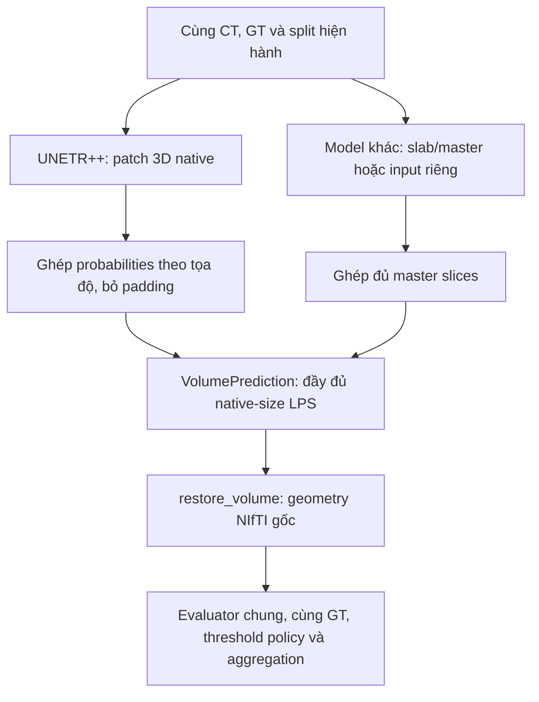

# CT thật → patch UNETR++ → probability volume chung

## 1. Trạng thái và điểm bắt đầu

Đã có code lấy CT thật qua reader MERGE, cắt patch 3D, chạy forward UNETR++ và
ghép output thành volume đầy đủ. Không thay kiến trúc model hay pipeline slab
cũ. Không train, không cập nhật trọng số, không tải checkpoint và không đánh
giá chất lượng mô hình. Model vẫn khởi tạo ngẫu nhiên.

Đọc tài liệu này sau [README](../README.md). Muốn hiểu kiến trúc trước, xem
[UNETR++ baseline](unetrpp_baseline.md). Bằng chứng kiểm tra của lần bổ sung
input nằm ở [verification.json](../analysis/unetrpp_input/verification.json).

## 2. Đi theo một volume thật để hiểu cách lấy input

Ca A-0025 sau reader hiện hành có shape `[Z,Y,X] = [61,512,512]`. Reader vẫn
thống nhất mảng về LPS, áp scaling NIfTI và giữ nguyên cường độ, spacing,
geometry cùng độ phân giải gốc. File NIfTI trên ổ đĩa không bị viết lại.

Model UNETR++ đã tích hợp có token grid cố định. Cấu hình tham chiếu nhận
`[B,1,64,128,128]`, nên slab cũ `[B,1,11,512,512]` không thể đưa thẳng vào.
Giải pháp mới đọc **volume**, không cố chuyển slab 11 lát thành volume 64 lát.

Với A-0025 và stride mặc định `(64,128,128)`:

1. Trục Y và X được chia thành bốn vùng 128 voxel: bắt đầu tại 0, 128, 256, 384.
2. Có 4×4 = **16 patch**, phủ đủ cả lát 512×512; không chọn vùng theo tổn thương.
3. Mỗi patch lấy 61 lát CT thật, thêm 3 lát padding ở cuối Z để đủ 64.
4. Mỗi lượt model nhận một hoặc một batch patch; không cần giữ tensor của 199
   volumes trong RAM.
5. Khi có output của đủ 16 patch, bỏ phần padding rồi đặt các vùng thật về đúng
   tọa độ để nhận probability volume `[61,512,512]`.

**Crop khác resize:** crop lấy một vùng nguyên vẹn; voxel ở `(z,y,x)` trong
vùng đó giữ đúng giá trị và khoảng cách vật lý như CT nguồn. Ví dụ vùng
128×128 ở góc trên trái không bị thu nhỏ từ 512×512. Dùng tất cả các vùng
để phủ cả CT. Resize sẽ nội suy ảnh để đổi số pixel; code mới không làm bước đó.

## 3. Cửa sổ, padding, overlap và valid-region mask

`PatchConfig` mặc định:

```python
from merit_covid.data.unetrpp_input import PatchConfig

config = PatchConfig(
    patch_size=(64,128,128),  # Theo Z,Y,X, phù hợp model tham chiếu.
    stride=None,            # None + overlap=None: stride bằng patch_size.
    overlap=None,
    padding_mode="edge",   # Lặp voxel biên trên mỗi chiều bị thiếu.
    assume_mm=False,        # Giữ kiểm tra đơn vị nghiêm ngặt như reader chung.
)
```

- Nếu số lát lớn hơn 64, dùng nhiều cửa sổ Z. Ví dụ Z=130, stride Z=64:
  các điểm bắt đầu là 0, 64, 66. Cửa sổ cuối kết thúc đúng biên 130.
- Quy tắc này áp dụng cả Z, Y, X, nên volume không phải 512×512 cũng được phủ đủ.
- Nếu một chiều ngắn hơn patch, crop toàn phần thật của chiều đó rồi padding
  **ở phía cuối**, không thêm padding phía đầu. Vị trí voxel thật không bị dịch.
- Có thể chọn `padding_mode="constant", padding_value=...` chủ động; không
  tự coi 0 hoặc một giá trị khác là HU của không khí. Cấu hình mặc định dùng edge.
- Mask GT 3D nếu được đọc thì padding bằng 0; các voxel padding vẫn **không phải
  nhãn GT có thật**. Code training sau này phải dùng valid mask để loại chúng.
- `valid_region [1,D,H,W]` là bool: True cho voxel thật, False cho padding.
  Nó chỉ phụ thuộc shape và tọa độ, không phụ thuộc mask tổn thương.

Cấu hình stride hoặc overlap, chọn một trong hai:

```python
config = PatchConfig(stride=(32,64,64))
# Tương đương stride ở trên với kích thước mặc định:
config = PatchConfig(overlap=(0.5,0.5,0.5))
```

Overlap là tỉ lệ theo từng chiều trong `[0,1)`. Stride được tính bằng
`max(1, floor(patch_size * (1-overlap)))`. Stride phải dương và không lớn hơn
patch để không tạo lỗ hổng. **Ngay cả overlap=0, cửa sổ cuối có thể chồng lên
cửa sổ trước** nếu kích thước volume không chia hết cho patch; đó là quy tắc
căn cửa sổ cuối vào biên, không phải cắt bỏ phần dư.

Đây là chính sách lấy patch và xử lý biên được ghi lại, chưa phải kết luận về
stride/overlap tối ưu cho thí nghiệm. Patch size khác dùng được cho kiểm thử
hình học; khi đưa vào model phải khớp `img_size` của instance model. Không tự
thay cấu hình kiến trúc để chạy một patch sai shape.

## 4. Dataset, split và nội dung batch

```python
from merit_covid.data.unetrpp_input import (
    PatchConfig, UNETRPPPatchDataset, make_patch_dataloader,
)

dataset = UNETRPPPatchDataset.from_split(
    manifest="data/covid19_20/cases.json",
    split_path="splits/covid19_20_5fold.json",
    fold=0,
    partition="train",
    config=PatchConfig(),
    require_mask=False,  # Inference CT-only: không mở file GT, kể cả manifest có đường dẫn.
    case_ids=["volume-covid19-A-0025"],  # Chỉ lấy một ca có sẵn trong partition để thử.
)
batch = next(iter(make_patch_dataloader(dataset, batch_size=1, num_workers=0)))
images = batch["image_patch"]
valid = batch["valid_region"]
print(images.shape, valid.shape)
```

`from_split()` đọc và xác minh split đã lưu bằng validator hiện hành; không tạo
split mới. Bỏ `case_ids` để lấy mọi ca trong partition được chọn. Không thể dùng
`case_ids` để lấy ca ngoài partition. `len(dataset)` đếm **patch**, không phải
volume. `len(dataset.cases)` đếm volume. Fold và danh sách ID không thay đổi.

| Trường sau batching | Shape/kiểu | Ý nghĩa |
| --- | --- | --- |
| `image_patch` | float32 `[B,1,64,128,128]` | CT crop + padding, giữ cường độ nguồn |
| `valid_region` | bool, cùng shape | Voxel thật/padding |
| `mask_patch`, chỉ khi `require_mask=True` | float32, cùng shape, 0/1 | GT **3D thực** cùng vùng CT; không nhân bản mask master |
| `patch_index` | integer `[B]` | Chỉ số patch trong riêng volume đó |
| `case_id`, `group_id` | list B chuỗi | Danh tính volume và group |
| `metadata` | list B dictionary | Geometry gốc, tọa độ patch, policy và nguồn split |

Metadata patch có `start_zyx` và `stop_zyx` **0-based, đầu lấy/cuối không lấy**,
`padding_zyx`, shape phần thật, patch count, shape volume ZYX, shape NIfTI XYZ,
affine/orientation gốc và LPS, transform khôi phục. Tọa độ patch cộng với
`canonical_affine_mm` đủ xác định vị trí vật lý từng voxel; affine dùng XYZ nên
đổi `(z,y,x)` thành `(x,y,z)` trước khi áp dụng affine. Policy ghi rõ native,
không resize/window/normalize/Z resampling, stride và cách padding.

Inference vẫn có thể đọc manifest chứa tên file mask để kiểm tra fingerprint
split, **không yêu cầu file mask tồn tại và không mở header/voxel GT**. Nếu tự
khởi tạo `UNETRPPPatchDataset([Case(..., mask=None, ...)])`, không cần đường dẫn
GT. Khi dùng canonical split, manifest cần giữ tên mask đã ghi để fingerprint
còn khớp; không sửa manifest/split để bỏ tên đó.

Khởi tạo Dataset chỉ đọc headers các ca được chọn. Khi lấy mẫu mới đọc voxel
qua `read_arrays()` hiện hành; cache tối đa một volume mỗi worker. Cache không
được gửi theo khi Windows tạo worker. Các patch/volume khác không được preload.
Shuffle patch toàn cohort có thể gây giải nén lại cùng CT nhiều lần vì cache
giới hạn; mặc định loader giữ thứ tự. Validation/test không cho shuffle.

Ba ca có đơn vị unknown vẫn theo quy ước cũ: chỉ dùng
`PatchConfig(assume_mm=True)` khi chủ động chấp nhận giả định mm. Đó không phải
xác minh đơn vị. Group/volume độc lập theo ID ghi nhận vẫn chưa chứng minh
patient-level independence nếu thiếu patient mapping đáng tin cậy.

## 5. Chạy thử một patch CT thật

Chạy từ repository root. Dùng môi trường đã cài model extra; không tải lại CT.

```powershell
.\.venv\Scripts\python.exe -m pip install -e ".[unetrpp,test]"
.\.venv\Scripts\python.exe examples/unetrpp_real_input.py

# Ghi report vào một file mới, chỉ JSON kiểm tra; không lưu CT/probability/checkpoint.
.\.venv\Scripts\python.exe examples/unetrpp_real_input.py --report outputs/real_input_check.json

# Có thể thử worker Windows hoặc vị trí patch khác trong cùng ca.
.\.venv\Scripts\python.exe examples/unetrpp_real_input.py --workers 1 --patch-index 15
```

Ví dụ mặc định đọc A-0025 thuộc fold 0/train, chỉ forward **một** patch bằng
model đầy đủ 42.951.355 tham số, deep supervision bật. Model được đặt `eval()`
và gọi trong `torch.inference_mode()`. Code lấy output chính, sigmoid ở lớp
xử lý output, kiểm tra hữu hạn và hash toàn bộ tham số trước/sau. Không backward.

Kết quả kiểm tra thực tế A-0025: input `[1,1,64,128,128]`, gồm 999.424 voxel thật
và 49.152 voxel padding; vùng thật khớp từng giá trị với reader chung. Tham số
giữ nguyên; GT không được đọc. Đây là bằng chứng kết nối phần mềm, không nói
mô hình dự đoán tốt. **Một patch không được coi là prediction đủ cả CT.**

## 6. Ghép output về volume

`PatchReconstructor` nhận **probabilities**, không nhận logits. Code inference
lấy `output[0]` khi model trả deep supervision; logits phụ không được trộn
vào cùng grid. Sigmoid chạy ở `engine/prediction.py`, không sửa `UNETRPP.forward()`.

Với mỗi patch, reconstructor chỉ cộng vùng `valid_shape` vào tọa độ thật của
volume và tăng bộ đếm tại các voxel đó. Sau khi nhận đủ patch:

`probability_zyx[z,y,x] = tổng probabilities phủ voxel / số patch phủ voxel`.

Đây là **trung bình đều của probabilities**. Không lấy trung bình logits rồi
mới sigmoid; không threshold từng patch; không tính hoặc trung bình metric
patch. Phần padding không tham gia tổng hoặc mẫu số. Patch có thể đến khác
thứ tự; sai case, tọa độ, geometry/policy, trùng patch, thiếu patch hoặc vùng
không được phủ sẽ báo lỗi. Sai shape, NaN/Inf và giá trị ngoài `[0,1]` bị từ chối.

Code gọi inference đầy đủ cho **một ca** khi caller chủ động cần:

```python
from merit_covid.models.unetrpp import UNETRPP
from merit_covid.engine.patch_inference import predict_patch_case

# dataset ở mục 4, require_mask=False; không đọc GT.
model = UNETRPP(in_channels=1, out_channels=1, do_ds=True).eval()
prediction = predict_patch_case(model, dataset, case_index=0, batch_size=1)

print(prediction.case_id)
print(prediction.probability_zyx.shape)  # A-0025: (61,512,512), float32 [0,1].
original_xyz = prediction.to_original_xyz()  # (512,512,61), geometry NIfTI gốc.
```

Hàm này forward toàn bộ patch của ca được chọn, không chấm metric. Nó không
tự chạy trên 199 ca và không phải training loop. Phiên kiểm tra thực tế chỉ
forward một patch A-0025; đường ghép đầy đủ được kiểm thử bằng volumes tổng
hợp, gồm cả forward UNETR++ cấu hình nhỏ. Chưa chạy inference đầy đủ trên toàn
bộ cohort thật. Chi phí phụ thuộc số patch, overlap, batch size và phần cứng.

Reconstructor giữ buffer tổng float32 và đếm uint32 trên toàn volume trong RAM;
ngoài ra reader giữ một CT. Khi kết thúc sẽ tạo array output và giải phóng
buffer tổng. Không phải tất cả patch hay tất cả CT đều đồng thời nằm trong RAM.

## 7. Output chung và so sánh công bằng



`VolumePrediction` có ba trường:

| Trường | Hợp đồng |
| --- | --- |
| `case_id` | ID volume |
| `probability_zyx` | float32 `[Z,H,W]`, hữu hạn, trong `[0,1]`, phủ đủ grid LPS native |
| `metadata` | Geometry gốc, restore transform và `prediction_policy` ghi cách chuẩn bị input/output |

Model 2D/master-slice có thể dùng
`prediction_from_slices(case_id, slice_predictions, metadata, policy=...)`.
Helper gọi **SliceReconstructor hiện có**, yêu cầu đủ từng lát đúng một lần,
rồi trả cùng loại `VolumePrediction`. Mô hình có head hai lớp phải tự chuyển
đúng foreground probability trước khi dùng hợp đồng chung; helper sigmoid
hiện tại chỉ nhận binary head một kênh.

Khi bước evaluation được triển khai sau này, `prediction.slice_predictions()`
đưa ra đúng iterator `(index, plane)` mà `VolumeEvaluator.evaluate_case()` hiện
có nhận được. Evaluator đó sẽ restore probability về NIfTI gốc trước threshold
và dùng mask gốc. Không có evaluator hoặc công thức metric mới cho UNETR++.

Các điều kiện so sánh vẫn phải được người chạy thí nghiệm tuân thủ: cùng ca,
fold/partition, GT và geometry; chọn threshold bằng validation rồi cố định
trên test; cùng evaluator và cách tổng hợp volume/group. Input giữa mô hình
có thể khác nhau. `input_policy`, `prediction_policy` và `selection` ghi lại
những khác biệt đó; chúng không tự chứng minh một thí nghiệm đã công bằng.
Normalization, hyperparameters và ngân sách training chưa được chọn ở bước này.

## 8. Chức năng file và thứ tự đọc source

| Thứ tự | File mới | Chức năng |
| --- | --- | --- |
| 1 | [config.py](../src/merit_covid/data/unetrpp_input/config.py) | Patch size/stride/overlap/padding; ghi policy |
| 2 | [tiling.py](../src/merit_covid/data/unetrpp_input/tiling.py) | Lập cửa sổ, crop, valid mask, tọa độ |
| 3 | [dataset.py](../src/merit_covid/data/unetrpp_input/dataset.py) | Gọi reader cũ, chọn split đã lưu, cache và DataLoader |
| 4 | [prediction.py](../src/merit_covid/engine/prediction.py) | Hợp đồng output, sigmoid, bridge master slices và restore |
| 5 | [patch_reconstruction.py](../src/merit_covid/engine/patch_reconstruction.py) | Ghép đầy đủ patches, xử lý overlap/padding |
| 6 | [patch_inference.py](../src/merit_covid/engine/patch_inference.py) | Forward từng batch, ghép một ca; không loss/metric |
| 7 | [unetrpp_real_input.py](../examples/unetrpp_real_input.py) | Ví dụ một patch CT thật đến forward |
| 8 | [test_unetrpp_input.py](../tests/test_unetrpp_input.py), [test_prediction_contract.py](../tests/test_prediction_contract.py) | Kiểm tra hình học và hợp đồng chung |

Package có thêm `data/unetrpp_input/__init__.py` để export API. Không có bản
reader, reorientation, intensity transform hoặc evaluator thứ hai. Hai đường
input dùng chung `data/pipeline/preprocessing.read_arrays()`; reader NIfTI
không bị sửa. Không thay model/adapter, split, config dữ liệu hoặc tests cũ.

## 9. Kiểm thử và công việc còn lại

```powershell
.\.venv\Scripts\python.exe -m pytest tests/test_unetrpp_input.py tests/test_prediction_contract.py -q
.\.venv\Scripts\python.exe -m pytest -q
.\.venv\Scripts\python.exe -m pip check
```

Tests tổng hợp kiểm tra crop nguyên giá trị, scaling NIfTI, LPS/LPI/hoán vị
trục/affine shear, CT–GT thẳng hàng, padding trên cả ba chiều, coverage, mean
overlap, restore, inference không mở GT, cache/Windows workers, split cũ và
hai loại input cùng output contract. Tests không công bố metric mô hình.

Kết quả local ngày 08/11/2026: **74 tests mới PASS, 0 FAIL, 0 SKIP; toàn bộ
262 tests PASS, 0 FAIL, 0 SKIP**, giữ đủ 188 tests trước đó. `pip check` và
build/import package đạt. Report A-0025 ghi rõ chỉ forward một patch CT thật;
không dùng kết quả đó để công bố hiệu suất.

Phần đã có: chuẩn bị patch CT thật; GT 3D tùy chọn đúng vùng; valid mask; input
policy; forward và ghép probabilities; output chuẩn và đường restore/evaluator
chung. Phần chưa làm: training, loss masking/deep supervision targets, lựa chọn
hyperparameters/normalization/ngân sách, checkpoint, chọn threshold trên
validation, đánh giá test, cross-validation và so sánh chất lượng mô hình.

Mã được kiểm thử local trên MERGE trước khi công bố. Sau khi nhận báo cáo,
người dùng đã xác nhận cho phép commit và push lên MERGE. Trạng thái Git trong
verification.json là snapshot lúc kiểm thử, trước bước công bố này.
